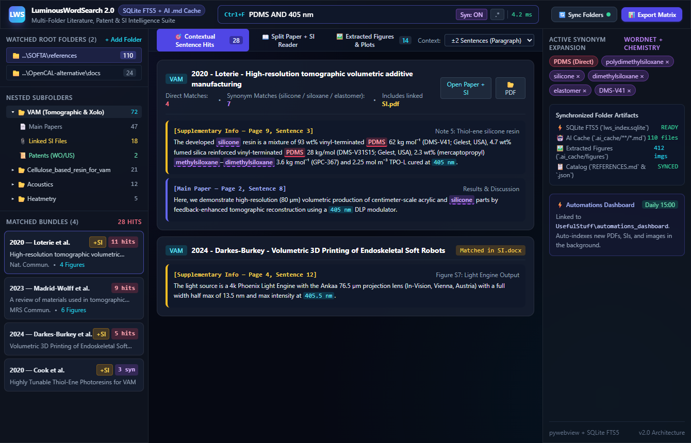

# LWS 2.0 — LuminousWordSearch
Literature, Patent & Supplementary Information (SI) Intelligence Suite



## Overview

**LWS 2.0** is a literature search engine and research intelligence suite for scientific papers, supplementary materials (SI), and patents. Built with high-speed `pypdfium2` extraction, SQLite FTS5 full-text indexing, WordNet + scientific chemical thesaurus expansion, and a dark glassmorphic interface powered by `pywebview`.

---

## Key Features

- **⚡ Blazing Fast Extraction:** Replaces legacy on-the-fly PDF parsing with `pypdfium2`, extracting text 10–25× faster across PDF, DOCX, and PPTX documents.
- **🔍 SQLite FTS5 Search:** Millisecond full-text sentence search with BM25 ranking, snippet generation, and syntax highlighting (`hit-direct`, `hit-synonym`).
- **🧬 Scientific & WordNet Thesaurus:** Domain-aware chemical expansion (PDMS, siloxane, TPO-L, LAP, CAL, GelMA) combined with NLTK WordNet.
- **🖼️ Figure & Caption Harvesting:** Automatic extraction of embedded figures and diagrams paired with page captions (`Figure`, `Fig.`, `Chart`, `Scheme`).
- **📑 Companion Bundling:** Automatically pairs main research papers with their companion Supplementary Information (SI), peer reviews, and slides.
- **📁 Recursive Multi-Root Folders:** Scans multiple watch directories and nested subfolders to any depth, preserving category hierarchy.
- **🎨 Modern Glassmorphic Interface:** Native desktop UI styled with dark glassmorphism (`#080B11`), split paper+SI reader, and figure galleries.
- **🤖 AI Agent Integration:** Continuously synchronizes full-text Markdown in `.ai_cache/*.md`, `references.json`, and master catalog `REFERENCES.md`.

---

## Quickstart

### 1. Requirements

Install dependencies using Python 3.10+:
```powershell
pip install -r requirements.txt
```

### 2. Launch the Application

To launch the interactive GUI:
```powershell
python LWS.py
```

### 3. Headless Synchronization (CLI)

To synchronize literature folders in background without opening the GUI:
```powershell
python LWS.py --dir "C:\Path\To\References" --headless-sync
```

Add `--no-figures` for faster text-only synchronization:
```powershell
python LWS.py --dir "C:\Path\To\References" --headless-sync --no-figures
```

---

## Architecture

```
LWS-LuminousWordSearch/
├── LWS.py                         # GUI launcher & CLI entrypoint
├── lws_engine/
│   ├── config.py                  # Multi-root workspace & MAX_PATH safety (\\?\)
│   ├── database.py                # Thread-safe SQLite FTS5 (WAL mode, RLock)
│   ├── extractors.py              # pypdfium2 PDF, DOCX, PPTX & sentence splitting
│   ├── figure_extractor.py        # Figure harvesting & caption regex matching
│   ├── bundler.py                 # Main, SI, Patent, Peer Review pairing
│   ├── thesaurus.py               # Chemical domain dictionary + WordNet
│   └── synchronizer.py            # Recursive synchronization & .ai_cache generator
├── web_ui/
│   ├── index.html                 # 3-pane glassmorphic layout
│   ├── styles.css                 # Dark theme, glassmorphic styling
│   └── app.js                     # Pywebview API bridge
└── tests/                         # 114 passing unit and integration tests
```

---

## License

This project is licensed under the [MIT License](LICENSE).
